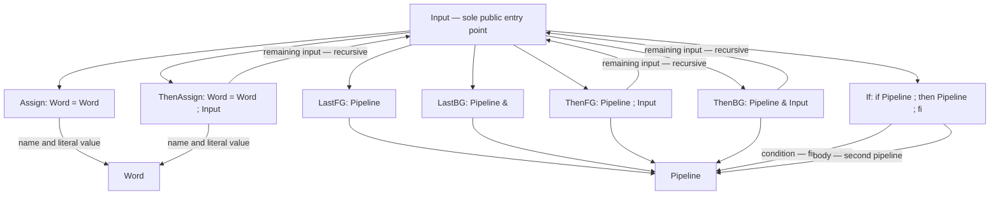
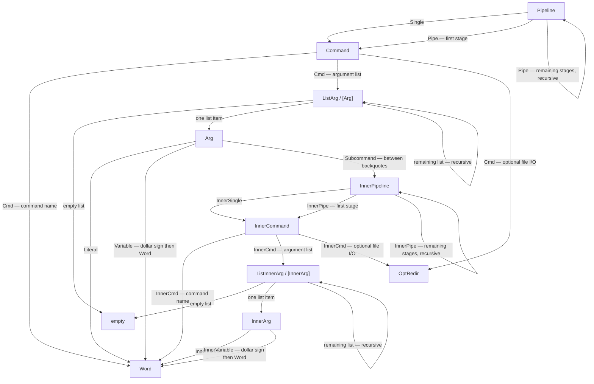
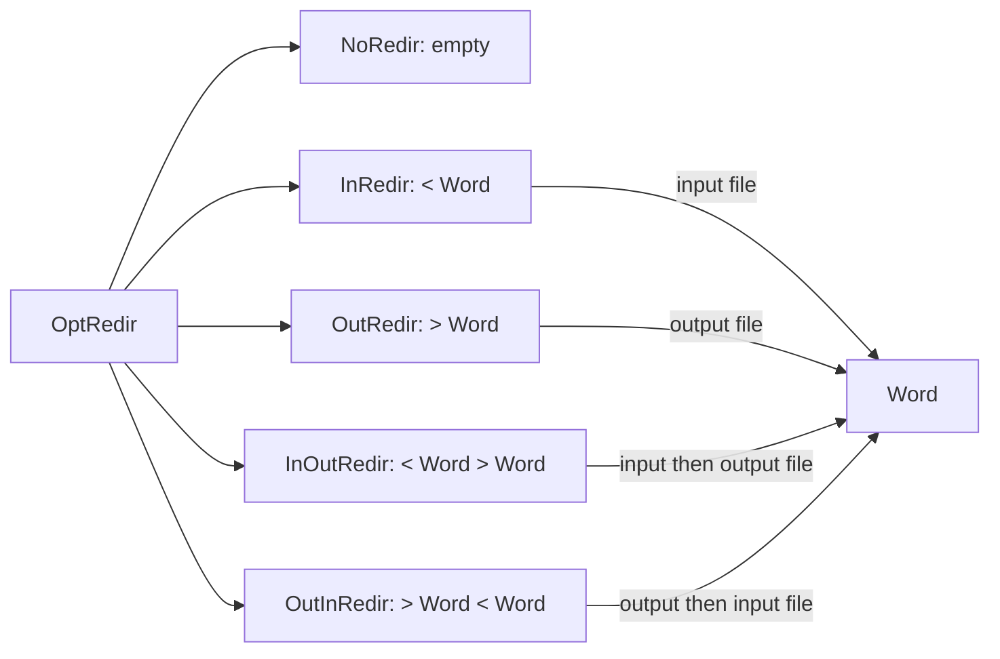

# Read the shell grammar

These diagrams describe [Grammar.cf](Grammar.cf), not the full POSIX shell.
Boxes are categories (nonterminals), tokens, or constructor alternatives.
An edge means “contains this part,” **not execution order**. An edge back to
its own category shows recursion. Quoted text in the rules is literal syntax.

## 1. Input and job overview



`ThenFG` and `ThenBG` store the first pipeline and the rest of the input.
`ThenAssign` does the same for an assignment. Thus `x=5 ; echo $x` is one
`ThenAssign` node with another `Input` inside it. A conditional has exactly
two pipelines, not two complete `Input` trees. This keeps its body small.
The runtime chooses whether to evaluate the second pipeline.

## 2. Commands, arguments, and inner pipelines



`Pipe` is right-recursive: `echo hi | cat | wc` holds the first `Command`,
then a `Pipeline` that contains `cat | wc`. `Single` ends this chain.
`InnerPipe` and `InnerSingle` use the same shape inside backquotes.

Both list categories permit zero or more items. BNFC's `separator Arg ""`
and `separator InnerArg ""` rules generate empty and cons list constructors;
no punctuation separates arguments. The lexer skips whitespace. The diagrams
show the logical list structure; BNFC can reverse an intermediate list during
parsing to preserve source argument order in the final AST.

An outer `Arg` can contain an `InnerPipeline`. An `InnerArg` **cannot** contain
a subcommand. There is no edge from `InnerArg` back to `InnerPipeline`. This
is how the grammar prevents nested backquotes without a lexer mode.

## 3. Per-command optional redirection



`OptRedir` is attached to `Command` and `InnerCommand`, not `Pipeline`.
For example, `cat < in.txt | wc > out.txt` gives each command its own
redirection node. `NoRedir` is a real AST constructor with no source token.
There is no repeated input, repeated output, append, or stderr rule.

## Token and runtime distinctions

`Word` is one or more letters, digits, or `_ . / - :`. Examples: `5`, `-l`,
`./input-file_1.txt`. `if`, `then`, and `fi` are reserved terminals, not words.
`$`, backquotes, `|`, `;`, `&`, `<`, `>`, and `=` are syntax tokens.
There are no quoting or escaping rules.

`echo`, `hello`, `cd`, `exit`, and `export` are all ordinary command-name
`Word` tokens. The grammar does not decide which commands use a thread,
a process, or the main thread. The runtime makes that decision after parsing.
Likewise, `Word` permits `5bad` as an assignment name; the runtime rejects it.

## Concrete AST, checked with the generated parser

Input:

```text
x=5 ; echo $x | wc -c
```

Generated abstract syntax (line-wrapped here only):

```text
(ThenAssign "x" "5"
  (LastFG
    (Pipe (Cmd "echo" [(Variable "x")] NoRedir)
      (Single (Cmd "wc" [(Literal "-c")] NoRedir)))))
```

Read it from the outside in:

1. `ThenAssign` stores the name `x`, literal value `5`, and remaining input.
2. `LastFG` says that the remaining pipeline runs in the foreground.
3. `Pipe` stores the first command and the remaining single-stage pipeline.
4. `Variable` records a lookup request; parsing does not replace `$x` with `5`.
5. Both commands have `NoRedir`. At runtime a system pipe connects them.

Reproduce this AST without executing commands:

```sh
printf 'x=5 ; echo $x | wc -c\n' | ./build/TestGrammar
```

The generated Bison file has an additional private untyped `ShellStart`
wrapper from `prepare_parser.py`. It only transfers AST ownership for cleanup;
it is not a `Grammar.cf` category, public entry point, or language feature.
