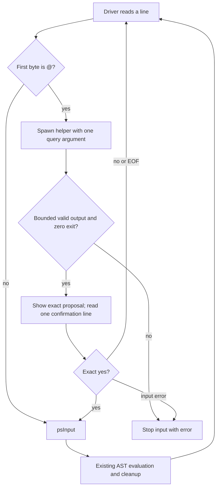

# Optional `@` input: helper prototype

This is driver preprocessing, **not a BNFC grammar extension**. `nl_input.c`
owns helper capture and confirmation. `shell.c` passes confirmed text to its
existing `psInput` / `execute_input` / `free_Input` path. Grammar.cf is unchanged.

## Try the fixed-response stub

Run from this directory after `make`:

```sh
BNF_NL_HELPER="$PWD/mysh_llm_stub.py" ./build/shell
```

Type `@please greet me`, then read the proposal and type `yes` to run it.
The stub always returns `echo hello`. It receives the real query but does not
interpret it. **It is not AI.** It has no model, RAG, network, or JSON catalog.
The real model work remains a separate ShellAI notebook task.

## Protocol

- Only an input whose **first byte** is `@` enters this mode. The driver removes
  that one byte. It preserves all remaining query spaces and punctuation.
- Set `BNF_NL_HELPER` to an absolute executable path. There is no PATH search,
  default helper, option parsing, or shell command string. `posix_spawn` passes
  the query as exactly `argv[1]`; `argv[2]` is NULL.
- Query length is 1..4,096 bytes. Driver input rejects NUL and has a separate
  65,536-byte line limit. A query can contain spaces or punctuation not accepted
  by the command grammar; those bytes are data for the helper.
- Helper stdin and stderr are `/dev/null`. Only stdout carries the proposal.
  The helper must exit zero and close stdout within a one-second monotonic
  deadline. Output capture reads before waiting and uses bounded storage.
- The proposal is one nonempty printable ASCII line, at most 4,096 bytes,
  excluding one optional final LF. No tabs, CR, extra LF, NUL, other control
  bytes, or non-ASCII bytes are allowed. All-space and `@`-prefixed proposals
  (including spaces before `@`) are rejected before display.
- The module shows the exact accepted proposal on stderr. It then asks for
  confirmation. Only the exact lowercase line `yes` approves. `y`, `YES`, spaces,
  an empty reply, or any other line cancels. EOF without a reply also cancels.
  The reply is consumed and is never parsed as a command.
- Confirmation uses the **same byte-wise stdin reader as command input**, on
  the main thread. It does not open `/dev/tty`. Piped scripts must supply a
  separate confirmation line. Do not pipe untrusted scripts into this shell:
  scripted `yes` is consent under this protocol, not proof of a human review.
- An invalid/overlong confirmation, query error, helper setup/exit/timeout
  error, or invalid output **ends shell input with status 1**. Pending script
  lines cannot become an unclaimed confirmation command. This includes a
  driver-overlong line that starts with `@`. Normal refusal consumes one line
  and resumes input without changing the preceding status.
- After approval, BNFC parses the proposal once. Invalid syntax executes
  nothing and follows the existing sticky syntax-error behavior. A valid
  proposal uses existing pipeline, variable, state, and job semantics.

## Flow (not grammar containment)



## Ownership and security limits

The module closes both pipe ends on all setup paths, kills the helper process
group on completion/error, and reaps only the direct helper PID. If that child
changes its group, cleanup also kills it by PID. Ordinary descendants in the
original helper group are stopped. Descendants that deliberately escape their
process group are **not contained**. The direct child is reaped after SIGKILL;
a kernel-level uninterruptible wait or stalled executable lookup is not given
a hard real-time guarantee. This is not a sandbox or a general job supervisor.

Choose a trusted local helper. It runs with the shell's user permissions and
inherited environment before confirmation. Confirmation guards evaluation of
its output; it does not guard the helper's own actions. An approved command can
write files, run processes, or change shell state. Existing command execution
has no timeout. Confirmation waits for user input without a timeout.

## Verification

`test_nl_input.py` uses real temporary executable helpers under `TMPDIR`, not
mocked responses. It covers exact argv, approval/refusal/EOF, pre-approval side
effects, stdin ownership, query/output limits, unsafe output, invalid syntax,
recursion, helper errors/signals/timeouts, process-group changes, and repeated
helper descriptor/child cleanup through Linux `/proc`. `make sanitize` includes
this suite and both new C files in its build. No allocator/spawn failure
injection, terminal device suite, or hostile daemon containment test is claimed.
